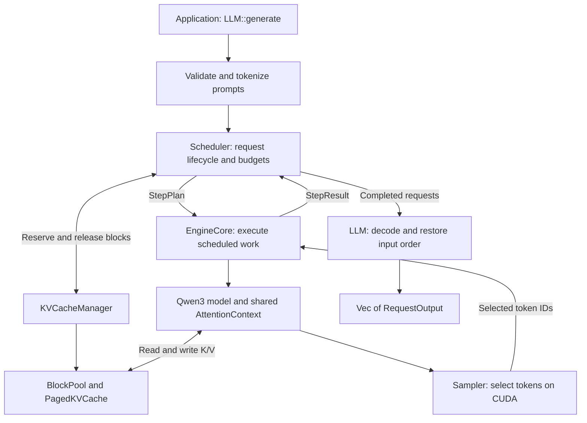

# Architecture

[Documentation](README.md) · [Getting started](getting-started.md) · [Development](development.md)

This page describes the shipped v0.2.0.rc.1 implementation: one in-process CUDA engine for synchronous, offline Qwen3 generation. [nano-vllm](https://github.com/GeeeekExplorer/nano-vllm) and [vLLM](https://github.com/vllm-project/vllm) inform the design; the supported API and execution scope are specific to this repository.

## One generation call

`LLM::new` resolves a checkpoint, loads its tokenizer and model, validates the CUDA device, warms representative model paths, and allocates one paged KV cache. `LLM::generate` validates a complete batch, tokenizes text prompts, admits requests, and drives the engine until they finish.

`EngineCore::step` asks the scheduler for a plan, prepares the attention state, executes the model and sampling work, and returns the result to the scheduler for application. The loop repeats internally; the public call returns completed results rather than streamed tokens.

The two internal values keep execution and request ownership separate:

| Value | Contents and responsibility |
|---|---|
| `StepPlan` | Immutable request identities, token ranges, causal positions, attention/cache mappings, per-request sampling policies, token budget, and permission to sample |
| `StepResult` | Matching plan identity and each participating request's selected token, if sampling was permitted; applied once by the scheduler |

A partial prefill chunk advances the cached prompt history without selecting a completion token. Sampling becomes eligible when prefill completes, or on a decode step. The scheduler validates result identity before updating state, so stale or mismatched results cannot advance a request.

## Who owns what

| Component | Responsibility | Source |
|---|---|---|
| `LLM` | Public construction/generation, tokenizer, model identity, output decoding and input order | [llm.rs](../crates/vllm-oxide/src/llm.rs) |
| `ResolvedModel` and weight loader | Bind configuration, tokenizer, safetensors, dtype, and special tokens to one checkpoint | [loader](../crates/vllm-oxide/src/loader/) |
| Model registry and `CausalLM` | Construct the declared architecture and expose the internal forward/logits contract | [models](../crates/vllm-oxide/src/models/), [causal_lm.rs](../crates/vllm-oxide/src/causal_lm.rs) |
| `Scheduler` and `Sequence` | Admission, request identity/lifecycle, fairness, token limits, preemption, and completion | [scheduler.rs](../crates/vllm-oxide/src/engine/scheduler.rs), [sequence.rs](../crates/vllm-oxide/src/engine/sequence.rs) |
| `EngineCore` | Execute one plan, prepare shared attention state, invoke model/sampler, and clean up a failed step | [engine/mod.rs](../crates/vllm-oxide/src/engine/mod.rs), [step.rs](../crates/vllm-oxide/src/engine/step.rs) |
| `KVCacheManager` | Scheduler-facing allocation/release and logical-to-physical slot mapping | [kv_cache_manager.rs](../crates/vllm-oxide/src/engine/kv_cache_manager.rs) |
| `BlockPool` | Physical block ownership, free list, reference counts, prefix hashes, and copy-on-write | [block_pool.rs](../crates/vllm-oxide/src/engine/block_pool.rs) |
| `PagedKVCache` and `AttentionContext` | GPU K/V storage and step-scoped, device-ready attention metadata shared across layers | [attention](../crates/vllm-oxide/src/attention/) |
| `Sampler` | Per-request penalties, greedy or stochastic token selection, and compact selected-token transfer | [sampler.rs](../crates/vllm-oxide/src/sampler.rs), [sampler/cuda.rs](../crates/vllm-oxide/src/sampler/cuda.rs) |

These components are internal. Applications use the six exported types: `LLM`, `EngineOptions`, `Prompt`, `SamplingParams`, `RequestOutput`, and `Source`. Internal execution types are not extension APIs.

## Scheduling and cache behavior

The scheduler can execute prefill and decode work within the same token budget. Long prompts are processed in chunks so prompt work can coexist with decode progress. Requests waiting for sequence or cache capacity remain queued within the current call.

The cache uses fixed blocks of 256 tokens. Prefix caching reuses eligible complete blocks with matching token histories; shared block ownership uses reference counts and copy-on-write. The `KVCacheManager` hides physical cache details from the scheduler. Under cache pressure, recompute preemption releases a request's active cache ownership and later reconstructs the required history.

Stable public request IDs belong to the accepted request, independently of internal sequence IDs or its position in a batch. `LLM` restores input order when it decodes completed outputs. A failed execution aborts active requests and releases cache ownership; the error is returned to the caller rather than converted into a successful partial batch.

## Model and numerical execution

[Candle](https://github.com/huggingface/candle) supplies tensors and CUDA integration. This RC uses Candle variable-length FlashAttention for prefill and the paged-windowed entrypoint for decode, plus project CUDA cache and sampling kernels. It predates the final release's bounded reference arithmetic and explicit GEMM/layout repairs. The 18 historical numerical failures remain attributed to their original measurements.

Normal CUDA generation keeps token-selection work on the device and copies the selected token IDs to the host. Maintainer captures and telemetry are separately gated by `internal-golden`; they are not part of the application's API or normal output contract.

## Read next

| Topic | Document |
|---|---|
| API configuration and errors | [Getting started](getting-started.md#rust-api) |
| Code layout and local checks | [Development](development.md) |
| Domain terms and dependency rules | [CONTEXT.md](../CONTEXT.md) |
| Supported API boundary | [ADR-0011](adr/0011-public-generation-contract.md) |
| Stable request identity | [ADR-0008](adr/0008-request-identity-and-output-order.md) |
| Numerical contract | [ADR-0015](adr/0015-layered-accuracy-validation.md) and [ADR-0018](adr/0018-freeze-layered-accuracy-budgets.md) |
| Historical RC evidence | [Validation](validation/README.md) |
| Earlier designs | [Architecture decision records](adr/) |

ADRs preserve the decisions and proposals at the time they were written. Their historical kernel choices and release procedures should be read with their status and the [original RC results](releases/v0.2.0-rc.1.en.md).
